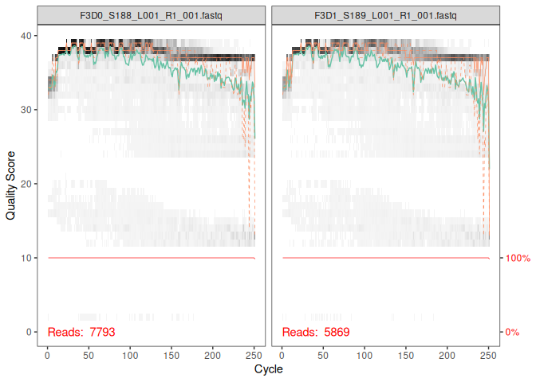
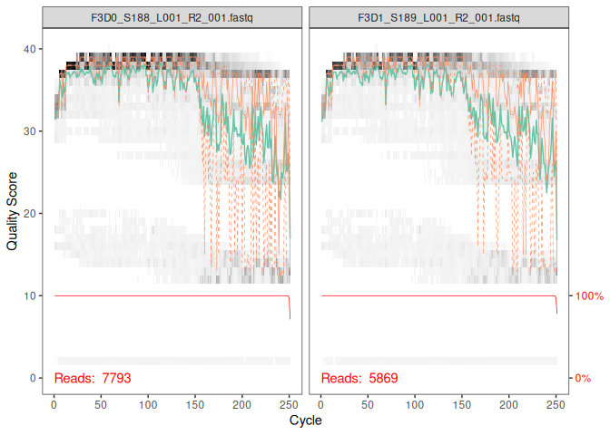
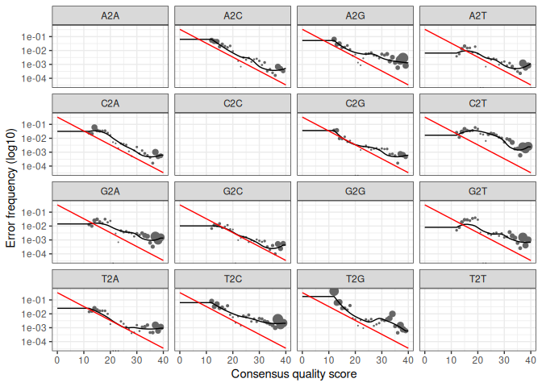
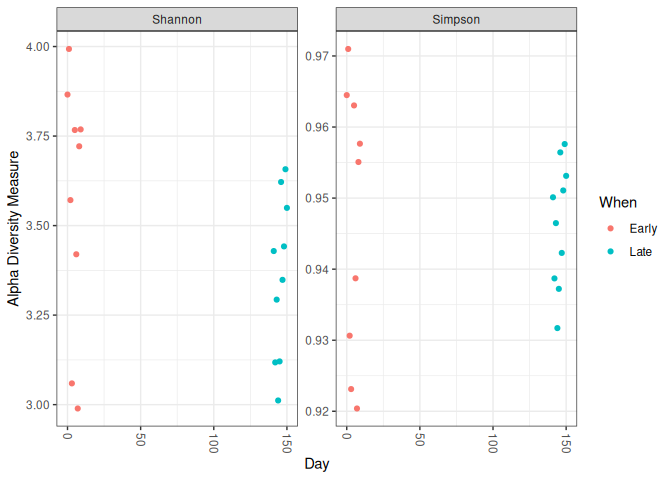
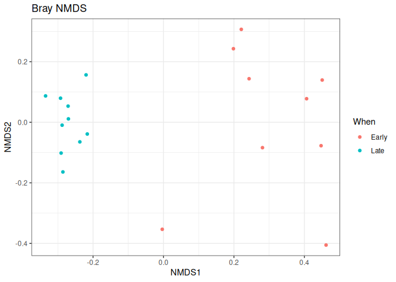
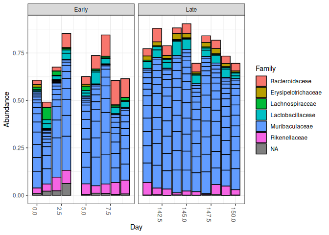

R Notebook
================

### DADA2 Pipeline Tutorial

## Préparation

``` r
library(dada2); packageVersion("dada2")
```

    ## Loading required package: Rcpp

    ## [1] '1.40.0'

``` r
path <- "/home/rstudio/tutoriel_dada2/tutoriel/data/MiSeq_SOP"
list.files(path)
```

    ##  [1] "F3D0_S188_L001_R1_001.fastq"   "F3D0_S188_L001_R2_001.fastq"  
    ##  [3] "F3D1_S189_L001_R1_001.fastq"   "F3D1_S189_L001_R2_001.fastq"  
    ##  [5] "F3D141_S207_L001_R1_001.fastq" "F3D141_S207_L001_R2_001.fastq"
    ##  [7] "F3D142_S208_L001_R1_001.fastq" "F3D142_S208_L001_R2_001.fastq"
    ##  [9] "F3D143_S209_L001_R1_001.fastq" "F3D143_S209_L001_R2_001.fastq"
    ## [11] "F3D144_S210_L001_R1_001.fastq" "F3D144_S210_L001_R2_001.fastq"
    ## [13] "F3D145_S211_L001_R1_001.fastq" "F3D145_S211_L001_R2_001.fastq"
    ## [15] "F3D146_S212_L001_R1_001.fastq" "F3D146_S212_L001_R2_001.fastq"
    ## [17] "F3D147_S213_L001_R1_001.fastq" "F3D147_S213_L001_R2_001.fastq"
    ## [19] "F3D148_S214_L001_R1_001.fastq" "F3D148_S214_L001_R2_001.fastq"
    ## [21] "F3D149_S215_L001_R1_001.fastq" "F3D149_S215_L001_R2_001.fastq"
    ## [23] "F3D150_S216_L001_R1_001.fastq" "F3D150_S216_L001_R2_001.fastq"
    ## [25] "F3D2_S190_L001_R1_001.fastq"   "F3D2_S190_L001_R2_001.fastq"  
    ## [27] "F3D3_S191_L001_R1_001.fastq"   "F3D3_S191_L001_R2_001.fastq"  
    ## [29] "F3D5_S193_L001_R1_001.fastq"   "F3D5_S193_L001_R2_001.fastq"  
    ## [31] "F3D6_S194_L001_R1_001.fastq"   "F3D6_S194_L001_R2_001.fastq"  
    ## [33] "F3D7_S195_L001_R1_001.fastq"   "F3D7_S195_L001_R2_001.fastq"  
    ## [35] "F3D8_S196_L001_R1_001.fastq"   "F3D8_S196_L001_R2_001.fastq"  
    ## [37] "F3D9_S197_L001_R1_001.fastq"   "F3D9_S197_L001_R2_001.fastq"  
    ## [39] "filtered"                      "HMP_MOCK.v35.fasta"           
    ## [41] "Mock_S280_L001_R1_001.fastq"   "Mock_S280_L001_R2_001.fastq"  
    ## [43] "mouse.dpw.metadata"            "mouse.time.design"            
    ## [45] "stability.batch"               "stability.files"

## 1 - Profils de qualité

``` r
fnFs <- sort(list.files(path, pattern="_R1_001.fastq", full.names = TRUE)) # Sélectionne seulement les fichiers forward
fnRs <- sort(list.files(path, pattern="_R2_001.fastq", full.names = TRUE)) # Seulement les fichiers reverse
sample.names <- sapply(strsplit(basename(fnFs), "_"), `[`, 1) # coupe le nom de fichier a chaque _, garde le 1er morceau : obtiens des noms d'échantillons propres
plotQualityProfile(fnFs[1:2]) #graphique que des forwards : sert a decider ou tronquer les reads 
```

<!-- -->

Le fond gris est une carte de chaleur de la fréquence de chaque score de
qualité à chaque position. La ligne verte est la qualité moyenne par
position, les lignes oranges sont les quartiles, et la ligne rouge est
la proportion de reads qui atteignent cette position. Elle est plate
avec Illumina, car tous les reads ont la même longueur.

L’analyse de 2 échantillons successifs se fait (en R1), le premier
compte 7793 séquences (reads) et le second 5869, toutes d’une longueur
de 250 paires de bases (pb).

Pour rappel, les fichiers au format FASTQ (qui commencent par @,
contrairement au format FASTA qui commence par \>) associent à chaque
lettre une note de qualité, le Q-score. Ce score évalue le risque qu’une
base soit fausse : un Q40 est excellent (1 risque sur 10000
(40-1/10000)), un Q30 est très bon (1 sur 1000), et un Q20 (1 sur 100)
est la limite basse à ne pas dépasser pour garder des résultats fiables.

``` r
plotQualityProfile(fnRs[1:2]) #graphique des reverses (R2)
```

<!-- --> Dans nos
données, les séquences forward sont de très bonne qualité. On peut
simplement couper la toute fin (vers 240 pb) là où la qualité commence à
baisser.

En revanche, les séquences reverse sont nettement de moins bonnes
qualité, surtout en fin de séquence. DADA2 en tient compte dans son
modèle d’erreur, et coupe là où la qualité s’effondre (vers 160 pb) afin
d’enlever les erreurs et de mieux détecter les variants rares.

Enfin, il faut garder assez de longueur pour pouvoir recoller les 2
bouts (R1 et R2). Avec 240 pb d’un côté et 160 pb de l’autre, on obtient
un total de 400 pb. Pour un amplicon (le morceau amplifié) d’environ 253
pb, cela laisse une zone de chevauchement d’environ 147 pb, ce qui est
parfait pour une fusion réussie.

## 2 - Filtration

``` r
# Noms des futurs fichiers filtrés
filtFs <- file.path(path, "filtered", paste0(sample.names, "_F_filt.fastq.gz")) 
filtRs <- file.path(path, "filtered", paste0(sample.names, "_R_filt.fastq.gz"))
names(filtFs) <- sample.names
names(filtRs) <- sample.names
```

``` r
# Création de ces fichiers
out <- filterAndTrim(fnFs, filtFs, fnRs, filtRs, truncLen=c(240,160),
              maxN=0, maxEE=c(2,2), truncQ=2, rm.phix=TRUE,
              compress=TRUE, multithread=FALSE) # compress : sortir les fichier en .gz
head(out)
```

    ##                               reads.in reads.out
    ## F3D0_S188_L001_R1_001.fastq       7793      7113
    ## F3D1_S189_L001_R1_001.fastq       5869      5299
    ## F3D141_S207_L001_R1_001.fastq     5958      5463
    ## F3D142_S208_L001_R1_001.fastq     3183      2914
    ## F3D143_S209_L001_R1_001.fastq     3178      2941
    ## F3D144_S210_L001_R1_001.fastq     4827      4312

Les résultats indique la comparaison entre les séquences de départ et
les séquences filtrés. Par exemple, pour F3D0, un passage de 7793 à 7113
séquences, soit 91 % de séquences conservés. Cela indique une perte
d’environ 9% correspondant aux reads de mauvaises qualités et donc qui
ont été retirés.

## 3 - Modèle d’erreur

``` r
# Chaque run de séquençage a son propre profils d'erreurs
errF <- learnErrors(filtFs, multithread=TRUE)
```

    ## 33514080 total bases in 139642 reads from 20 samples will be used for learning the error rates.

``` r
errR <- learnErrors(filtRs, multithread=TRUE)
```

    ## 22342720 total bases in 139642 reads from 20 samples will be used for learning the error rates.

``` r
plotErrors(errF, nominalQ=TRUE) # vérification du mo
```

    ## Warning in scale_y_log10(): log-10 transformation introduced infinite values.

    ## Warning: Removed 164 rows containing missing values or values outside the scale range
    ## (`geom_line()`).
    ## Removed 164 rows containing missing values or values outside the scale range
    ## (`geom_line()`).

<!-- --> Le
calcul utilise 139642 reads de 20 échantillons, soit 33514080 bases en
forward et 22342720 en reverse.

Le graphique indique que les points sont les taux d’erreur observés, la
ligne noire est le modèle estimé et la ligne rouge est le taux attendu
d’après la définition théorique du Q-score. Cela conclut que la ligne
noire suit bien les points et que l’erreur baisse quand la qualité
monte.

## 4 - Inférence

Dada est un modèle d’erreur pour distinguer les vraies séquences des
erreurs de séquençage. Il en ressort des Amplicon Sequence Variants
(ASV).

``` r
dadaFs <- dada(filtFs, err=errF, multithread=TRUE) #
```

    ## Sample 1 - 7113 reads in 1979 unique sequences.
    ## Sample 2 - 5299 reads in 1639 unique sequences.
    ## Sample 3 - 5463 reads in 1477 unique sequences.
    ## Sample 4 - 2914 reads in 904 unique sequences.
    ## Sample 5 - 2941 reads in 939 unique sequences.
    ## Sample 6 - 4312 reads in 1267 unique sequences.
    ## Sample 7 - 6741 reads in 1756 unique sequences.
    ## Sample 8 - 4560 reads in 1438 unique sequences.
    ## Sample 9 - 15637 reads in 3590 unique sequences.
    ## Sample 10 - 11413 reads in 2762 unique sequences.
    ## Sample 11 - 12017 reads in 3021 unique sequences.
    ## Sample 12 - 5032 reads in 1566 unique sequences.
    ## Sample 13 - 18075 reads in 3707 unique sequences.
    ## Sample 14 - 6250 reads in 1479 unique sequences.
    ## Sample 15 - 4052 reads in 1195 unique sequences.
    ## Sample 16 - 7369 reads in 1832 unique sequences.
    ## Sample 17 - 4765 reads in 1183 unique sequences.
    ## Sample 18 - 4871 reads in 1382 unique sequences.
    ## Sample 19 - 6504 reads in 1709 unique sequences.
    ## Sample 20 - 4314 reads in 897 unique sequences.

Le résultat des fowards donne le nombre de reads et le nombre de
séquences uniques.

``` r
dadaRs <- dada(filtRs, err=errR, multithread=TRUE)
```

    ## Sample 1 - 7113 reads in 1660 unique sequences.
    ## Sample 2 - 5299 reads in 1349 unique sequences.
    ## Sample 3 - 5463 reads in 1335 unique sequences.
    ## Sample 4 - 2914 reads in 853 unique sequences.
    ## Sample 5 - 2941 reads in 880 unique sequences.
    ## Sample 6 - 4312 reads in 1286 unique sequences.
    ## Sample 7 - 6741 reads in 1803 unique sequences.
    ## Sample 8 - 4560 reads in 1265 unique sequences.
    ## Sample 9 - 15637 reads in 3414 unique sequences.
    ## Sample 10 - 11413 reads in 2522 unique sequences.
    ## Sample 11 - 12017 reads in 2771 unique sequences.
    ## Sample 12 - 5032 reads in 1415 unique sequences.
    ## Sample 13 - 18075 reads in 3290 unique sequences.
    ## Sample 14 - 6250 reads in 1390 unique sequences.
    ## Sample 15 - 4052 reads in 1134 unique sequences.
    ## Sample 16 - 7369 reads in 1635 unique sequences.
    ## Sample 17 - 4765 reads in 1084 unique sequences.
    ## Sample 18 - 4871 reads in 1161 unique sequences.
    ## Sample 19 - 6504 reads in 1502 unique sequences.
    ## Sample 20 - 4314 reads in 732 unique sequences.

Le résultat montre les même nombre de reads que pour le forwards mais le
les séquences uniques est diminué (séquences plus courtes).

``` r
dadaFs[[1]]
```

    ## dada-class: object describing DADA2 denoising results
    ## 128 sequence variants were inferred from 1979 input unique sequences.
    ## Key parameters: OMEGA_A = 1e-40, OMEGA_C = 1e-40, BAND_SIZE = 16

Pour l’échantillon 1 en forward, 1979 séquences uniques donnent 128
variants réels (ASV). La majorité des séquences uniques sont donc des
variants d’erreur de séquençage, que DADA2 rattache à leur séquence
vraie. Les reverse ont 1660 séquences uniques.

## 5 - Fusion

``` r
# Fusionne chaque read R1 avec son read R2 grâce a la zone de chevauchement
mergers <- mergePairs(dadaFs, filtFs, dadaRs, filtRs, verbose=TRUE) 
```

    ## 6540 paired-reads (in 107 unique pairings) successfully merged out of 6891 (in 197 pairings) input.

    ## 5028 paired-reads (in 101 unique pairings) successfully merged out of 5190 (in 157 pairings) input.

    ## 4986 paired-reads (in 81 unique pairings) successfully merged out of 5267 (in 166 pairings) input.

    ## 2595 paired-reads (in 52 unique pairings) successfully merged out of 2754 (in 108 pairings) input.

    ## 2553 paired-reads (in 60 unique pairings) successfully merged out of 2785 (in 119 pairings) input.

    ## 3646 paired-reads (in 55 unique pairings) successfully merged out of 4109 (in 157 pairings) input.

    ## 6079 paired-reads (in 81 unique pairings) successfully merged out of 6514 (in 198 pairings) input.

    ## 3968 paired-reads (in 91 unique pairings) successfully merged out of 4388 (in 187 pairings) input.

    ## 14233 paired-reads (in 143 unique pairings) successfully merged out of 15355 (in 352 pairings) input.

    ## 10528 paired-reads (in 120 unique pairings) successfully merged out of 11165 (in 278 pairings) input.

    ## 11154 paired-reads (in 137 unique pairings) successfully merged out of 11797 (in 298 pairings) input.

    ## 4349 paired-reads (in 85 unique pairings) successfully merged out of 4802 (in 179 pairings) input.

    ## 17431 paired-reads (in 153 unique pairings) successfully merged out of 17812 (in 272 pairings) input.

    ## 5850 paired-reads (in 81 unique pairings) successfully merged out of 6095 (in 159 pairings) input.

    ## 3716 paired-reads (in 86 unique pairings) successfully merged out of 3894 (in 147 pairings) input.

    ## 6865 paired-reads (in 99 unique pairings) successfully merged out of 7191 (in 187 pairings) input.

    ## 4426 paired-reads (in 67 unique pairings) successfully merged out of 4603 (in 127 pairings) input.

    ## 4576 paired-reads (in 101 unique pairings) successfully merged out of 4739 (in 174 pairings) input.

    ## 6092 paired-reads (in 109 unique pairings) successfully merged out of 6315 (in 173 pairings) input.

    ## 4269 paired-reads (in 20 unique pairings) successfully merged out of 4281 (in 28 pairings) input.

``` r
head(mergers[[1]])
```

    ##                                                                                                                                                                                                                                                       sequence
    ## 1 TACGGAGGATGCGAGCGTTATCCGGATTTATTGGGTTTAAAGGGTGCGCAGGCGGAAGATCAAGTCAGCGGTAAAATTGAGAGGCTCAACCTCTTCGAGCCGTTGAAACTGGTTTTCTTGAGTGAGCGAGAAGTATGCGGAATGCGTGGTGTAGCGGTGAAATGCATAGATATCACGCAGAACTCCGATTGCGAAGGCAGCATACCGGCGCTCAACTGACGCTCATGCACGAAAGTGTGGGTATCGAACAGG
    ## 2 TACGGAGGATGCGAGCGTTATCCGGATTTATTGGGTTTAAAGGGTGCGTAGGCGGCCTGCCAAGTCAGCGGTAAAATTGCGGGGCTCAACCCCGTACAGCCGTTGAAACTGCCGGGCTCGAGTGGGCGAGAAGTATGCGGAATGCGTGGTGTAGCGGTGAAATGCATAGATATCACGCAGAACCCCGATTGCGAAGGCAGCATACCGGCGCCCTACTGACGCTGAGGCACGAAAGTGCGGGGATCAAACAGG
    ## 3 TACGGAGGATGCGAGCGTTATCCGGATTTATTGGGTTTAAAGGGTGCGTAGGCGGGCTGTTAAGTCAGCGGTCAAATGTCGGGGCTCAACCCCGGCCTGCCGTTGAAACTGGCGGCCTCGAGTGGGCGAGAAGTATGCGGAATGCGTGGTGTAGCGGTGAAATGCATAGATATCACGCAGAACTCCGATTGCGAAGGCAGCATACCGGCGCCCGACTGACGCTGAGGCACGAAAGCGTGGGTATCGAACAGG
    ## 4 TACGGAGGATGCGAGCGTTATCCGGATTTATTGGGTTTAAAGGGTGCGTAGGCGGGCTTTTAAGTCAGCGGTAAAAATTCGGGGCTCAACCCCGTCCGGCCGTTGAAACTGGGGGCCTTGAGTGGGCGAGAAGAAGGCGGAATGCGTGGTGTAGCGGTGAAATGCATAGATATCACGCAGAACCCCGATTGCGAAGGCAGCCTTCCGGCGCCCTACTGACGCTGAGGCACGAAAGTGCGGGGATCGAACAGG
    ## 5 TACGGAGGATGCGAGCGTTATCCGGATTTATTGGGTTTAAAGGGTGCGCAGGCGGACTCTCAAGTCAGCGGTCAAATCGCGGGGCTCAACCCCGTTCCGCCGTTGAAACTGGGAGCCTTGAGTGCGCGAGAAGTAGGCGGAATGCGTGGTGTAGCGGTGAAATGCATAGATATCACGCAGAACTCCGATTGCGAAGGCAGCCTACCGGCGCGCAACTGACGCTCATGCACGAAAGCGTGGGTATCGAACAGG
    ## 6 TACGGAGGATGCGAGCGTTATCCGGATTTATTGGGTTTAAAGGGTGCGTAGGCGGGATGCCAAGTCAGCGGTAAAAAAGCGGTGCTCAACGCCGTCGAGCCGTTGAAACTGGCGTTCTTGAGTGGGCGAGAAGTATGCGGAATGCGTGGTGTAGCGGTGAAATGCATAGATATCACGCAGAACTCCGATTGCGAAGGCAGCATACCGGCGCCCTACTGACGCTGAGGCACGAAAGCGTGGGTATCGAACAGG
    ##   abundance forward reverse nmatch nmismatch nindel prefer accept
    ## 1       579       1       1    148         0      0      1   TRUE
    ## 2       470       2       2    148         0      0      2   TRUE
    ## 3       449       3       4    148         0      0      1   TRUE
    ## 4       430       4       3    148         0      0      2   TRUE
    ## 5       345       5       6    148         0      0      1   TRUE
    ## 6       282       6       5    148         0      0      2   TRUE

Pour F3D0, 6540 paires fusionnent sur 6891, soit 95 %. Le dernier
échantillon monte à 99,7 %. Par défaut, la fusion exige au moins 12 pb
de recouvrement et aucune différence dans la zone de recouvrement.

Dans “mergers”, chaque ligne est un ASV fusionné avec son abundance (le
premier compte 579 reads). Les colonnes forward et reverse indiquent
quels variants R1 et R2 ont été assemblés. Ca signifie un recouvrement
parfait de 148 pb, et accepte que la paire est retenue.

## 6 - Table de séquences et chimères

``` r
# Contruction de la matrice échantillons x ASV
seqtab <- makeSequenceTable(mergers)
dim(seqtab)
```

    ## [1]  20 293

Les résultats indiquent 20 échantillons (19 de souris et le Mock) et 293
ASV. Auncun échantillon n’a été perdu.

``` r
table(nchar(getSequences(seqtab))) # Contrôle la longueur des séquences
```

    ## 
    ## 251 252 253 254 255 
    ##   1  88 196   6   2

Les longueurs vont de 251 à 255 pb, avec 284 séquences sur 293 à 252 ou
253 pb. C’est cohérent avec la région V4. Des longueurs très différentes
auraient signalé une amplification non spécifique.

``` r
# retirer les chimères (séquence artificielle créee pendant la PCR)
seqtab.nochim <- removeBimeraDenovo(seqtab, method="consensus", multithread=TRUE, verbose=TRUE)
```

    ## Identified 61 bimeras out of 293 input sequences.

``` r
dim(seqtab.nochim) # affiche les dimension de la table
```

    ## [1]  20 232

61 ASV sur 293 sont des chimères (environ 21 % des variantes), ce qui
laisse 232 ASV.

``` r
# Proportion de reads conservés après le retrait des chimères
sum(seqtab.nochim)/sum(seqtab)
```

    ## [1] 0.9640374

Il y a 96% de reads après le retrait de chimères, ainsi la proportion de
chimère représente 4% dans l’ensemble du jeu de donnée. Les chimères
sont nombreuses mais peu abondantes.

## 7 - Suivi des reads

``` r
getN <- function(x) sum(getUniques(x))
track <- cbind(out, sapply(dadaFs, getN), sapply(dadaRs, getN), sapply(mergers, getN), rowSums(seqtab.nochim)) # track rassemble le nombre de reads à chaque étape
colnames(track) <- c("input", "filtered", "denoisedF", "denoisedR", "merged", "nonchim")
rownames(track) <- sample.names
head(track)
```

    ##        input filtered denoisedF denoisedR merged nonchim
    ## F3D0    7793     7113      6976      6979   6540    6528
    ## F3D1    5869     5299      5227      5239   5028    5017
    ## F3D141  5958     5463      5331      5357   4986    4863
    ## F3D142  3183     2914      2799      2830   2595    2521
    ## F3D143  3178     2941      2822      2868   2553    2519
    ## F3D144  4827     4312      4151      4228   3646    3507

Ce tableau suit le nombre de reads conservés à chaque étape du pipeline.
Il permet de repérer où l’on perd des données et de vérifier que le
pipeline a bien fonctionné. Le tutoriel indique que, hors filtrage,
aucune étape ne doit faire perdre la majorité des reads.

Prenons F3D144 par exemple, nn part de 4827 reads, il en reste 4312
après le filtrage, environ 4151 (forwards) et 4228 (reverse) après le
débruitage, 3646 après la fusion, et 3507 après le retrait des chimères.
Cela représente environ 73 % des reads de départ. Les deux plus grosses
pertes ont lieu au filtrage (environ 515 reads) et à la fusion (environ
505 reads), tandis que le débruitage et les chimères en retirent bien
moins.

Pour F3D0, on passe de 7793 à 7113 reads après le filtrage, puis à
environ 6976 après le débruitage, 6540 après la fusion et 6528 après le
retrait des chimères, soit environ 84 % des reads de départ. Ici, la
perte principale se fait aussi au filtrage, et presque rien n’est perdu
aux chimères.

Aucune perte n’est excessive, donc le pipeline a bien fonctionné. Si
beaucoup de reads disparaissaient à la fusion, il faudrait revoir
“truncLen”. S’ils disparaissaient aux chimères, il faudrait vérifier que
les amorces ont bien été retirées.

## 8 - Taxonomie

``` r
taxa <- assignTaxonomy(seqtab.nochim, "/home/rstudio/tutoriel_dada2/tutoriel/silva_nr99_v138.2_toGenus_trainset.fa.gz", multithread=FALSE) #compare chaque ASV à la base de référence SILVA
taxa.print <- taxa # Copie dont on enlève les noms de lignes pour l'affichage
rownames(taxa.print) <- NULL
head(taxa.print)
```

    ##      Kingdom    Phylum         Class         Order           Family          
    ## [1,] "Bacteria" "Bacteroidota" "Bacteroidia" "Bacteroidales" "Muribaculaceae"
    ## [2,] "Bacteria" "Bacteroidota" "Bacteroidia" "Bacteroidales" "Muribaculaceae"
    ## [3,] "Bacteria" "Bacteroidota" "Bacteroidia" "Bacteroidales" "Muribaculaceae"
    ## [4,] "Bacteria" "Bacteroidota" "Bacteroidia" "Bacteroidales" "Muribaculaceae"
    ## [5,] "Bacteria" "Bacteroidota" "Bacteroidia" "Bacteroidales" "Bacteroidaceae"
    ## [6,] "Bacteria" "Bacteroidota" "Bacteroidia" "Bacteroidales" "Muribaculaceae"
    ##      Genus        
    ## [1,] NA           
    ## [2,] NA           
    ## [3,] NA           
    ## [4,] NA           
    ## [5,] "Bacteroides"
    ## [6,] NA

Les 6 premiers ASV sont tous des Bacteria \> Bacteroidota \> Bacteroidia
\> Bacteroidales : cinq Muribaculaceae et un Bacteroidaceae du genre
Bacteroides. C’est attendu, car le tutoriel note que les Bacteroidetes
dominent dans les fèces de souris. Les nombreux NA au niveau du genre ne
signifient pas que le genre n’existe pas, mais que le classifieur n’a
pas pu l’attribuer avec assez de confiance. Le fragment V4 est court
(environ 253 pb), et les bases de référence couvrent encore mal le
microbiote intestinal de la souris.

## 9 - Echantillon Mock

L’échantillon Mock est une communauté artificielle de composition
connue.

``` r
unqs.mock <- seqtab.nochim["Mock",]
unqs.mock <- sort(unqs.mock[unqs.mock>0], decreasing=TRUE) # Drop ASVs absent in the Mock
cat("DADA2 inferred", length(unqs.mock), "sample sequences present in the Mock community.\n")
```

    ## DADA2 inferred 20 sample sequences present in the Mock community.

``` r
mock.ref <- getSequences(file.path(path, "HMP_MOCK.v35.fasta"))
match.ref <- sum(sapply(names(unqs.mock), function(x) any(grepl(x, mock.ref)))) # Séquence de réference
cat("Of those,", sum(match.ref), "were exact matches to the expected reference sequences.\n")
```

    ## Of those, 20 were exact matches to the expected reference sequences.

DADA2 trouve 20 ASV, tous identiques à la référence : 20 correspondances
exactes sur 20. Le taux d’erreur résiduel est donc de 0 %. La communauté
devait compter 21 souches, mais P. acnes est absente des données brutes.
Le pipeline est alors validée.

## 10 - Phyloseq

``` r
install.packages("igraph", type = "source") 
```

    ## Installing package into '/usr/local/lib/R/site-library'
    ## (as 'lib' is unspecified)

``` r
BiocManager::install("phyloseq", update = FALSE)
```

    ## 'getOption("repos")' replaces Bioconductor standard repositories, see
    ## 'help("repositories", package = "BiocManager")' for details.
    ## Replacement repositories:
    ##     CRAN: https://p3m.dev/cran/__linux__/resolute/latest

    ## Bioconductor version 3.23 (BiocManager 1.30.27), R 4.6.2 (2026-10-29)

    ## Warning: package(s) not installed when version(s) same as or greater than current; use
    ##   `force = TRUE` to re-install: 'phyloseq'

``` r
library(phyloseq); packageVersion("phyloseq")
```

    ## [1] '1.56.0'

``` r
library(Biostrings); packageVersion("Biostrings")
```

    ## Loading required package: BiocGenerics

    ## Loading required package: generics

    ## 
    ## Attaching package: 'generics'

    ## The following objects are masked from 'package:base':
    ## 
    ##     as.difftime, as.factor, as.ordered, intersect, is.element, setdiff,
    ##     setequal, union

    ## 
    ## Attaching package: 'BiocGenerics'

    ## The following objects are masked from 'package:stats':
    ## 
    ##     IQR, mad, sd, var, xtabs

    ## The following objects are masked from 'package:base':
    ## 
    ##     anyDuplicated, aperm, append, as.data.frame, basename, cbind,
    ##     colnames, dirname, do.call, duplicated, eval, evalq, Filter, Find,
    ##     get, grep, grepl, is.unsorted, lapply, Map, mapply, match, mget,
    ##     order, paste, pmax, pmax.int, pmin, pmin.int, Position, rank,
    ##     rbind, Reduce, rownames, sapply, saveRDS, table, tapply, unique,
    ##     unsplit, which.max, which.min

    ## Loading required package: S4Vectors

    ## Loading required package: stats4

    ## 
    ## Attaching package: 'S4Vectors'

    ## The following object is masked from 'package:utils':
    ## 
    ##     findMatches

    ## The following objects are masked from 'package:base':
    ## 
    ##     expand.grid, I, unname

    ## Loading required package: IRanges

    ## 
    ## Attaching package: 'IRanges'

    ## The following object is masked from 'package:phyloseq':
    ## 
    ##     distance

    ## Loading required package: XVector

    ## Loading required package: Seqinfo

    ## 
    ## Attaching package: 'Biostrings'

    ## The following object is masked from 'package:base':
    ## 
    ##     strsplit

    ## [1] '2.80.2'

``` r
library(ggplot2); packageVersion("ggplot2")
```

    ## [1] '4.0.4'

``` r
theme_set(theme_bw()) # permet de créer les graphiques avec ggplot2
samples.out <- rownames(seqtab.nochim) # permet de crée un tableau avec les métadonnées
subject <- sapply(strsplit(samples.out, "D"), `[`, 1) #coupe au niveau du D
gender <- substr(subject,1,1) 
subject <- substr(subject,2,999)
day <- as.integer(sapply(strsplit(samples.out, "D"), `[`, 2))
samdf <- data.frame(Subject=subject, Gender=gender, Day=day) 
samdf$When <- "Early" 
samdf$When[samdf$Day>100] <- "Late"
rownames(samdf) <- samples.out

#contient le 3 tableaux précèdent
ps <- phyloseq(otu_table(seqtab.nochim, taxa_are_rows=FALSE),
               sample_data(samdf),
               tax_table(taxa))
ps <- prune_samples(sample_names(ps) != "Mock", ps) # Remove mock sample

# stocker les séquences ADN des ASV dans phyloseq
dna <- Biostrings::DNAStringSet(taxa_names(ps))
names(dna) <- taxa_names(ps)
ps <- merge_phyloseq(ps, dna)
taxa_names(ps) <- paste0("ASV", seq(ntaxa(ps)))
ps
```

    ## phyloseq-class experiment-level object
    ## otu_table()   OTU Table:         [ 232 taxa and 19 samples ]
    ## sample_data() Sample Data:       [ 19 samples by 4 sample variables ]
    ## tax_table()   Taxonomy Table:    [ 232 taxa by 6 taxonomic ranks ]
    ## refseq()      DNAStringSet:      [ 232 reference sequences ]

Le nombre de séquences est identique aux nombres de taxa, il n’y a pas
de perte et donc il y a une corrèlation.

``` r
# mesure de la diversité alpha (interieur de l'échantillon)
plot_richness(ps, x="Day", measures=c("Shannon", "Simpson"), color="When") #Shannon augmente quand il y a plus d'ASV et que abondances sont équilibrés. Simpson est la probabilité que 2 reads tirés au hasard appartiennent à 2 ASV différents (va de 0 à 1, plus c'est proche de 1 plus la diversité est forte).
```

    ## Warning in estimate_richness(physeq, split = TRUE, measures = measures): The data you have provided does not have
    ## any singletons. This is highly suspicious. Results of richness
    ## estimates (for example) are probably unreliable, or wrong, if you have already
    ## trimmed low-abundance taxa from the data.
    ## 
    ## We recommended that you find the un-trimmed data and retry.

    ## Warning: `aes_string()` was deprecated in ggplot2 3.0.0.
    ## ℹ Please use tidy evaluation idioms with `aes()`.
    ## ℹ See also `vignette("ggplot2-in-packages")` for more information.
    ## ℹ The deprecated feature was likely used in the phyloseq package.
    ##   Please report the issue at <https://github.com/joey711/phyloseq/issues>.
    ## This warning is displayed once per session.
    ## Call `lifecycle::last_lifecycle_warnings()` to see where this warning was
    ## generated.

<!-- -->
L’indice de Shannon augmente avec le nombre d’ASV, mais aussi avec
l’équitabilité de leur répartition : plus il y a d’ASV et plus leurs
abondances sont équilibrées, plus l’indice est élevé. L’indice de
Simpson, tel que calculé par phyloseq, correspond à la probabilité que
deux reads tirés au hasard appartiennent à deux ASV différentes. Il
varie de 0 à 1, et une valeur proche de 1 indique une forte diversité.

Chaque point représente un échantillon, et les échantillons sont séparés
en deux groupes, Early et Late. Pour Shannon, les échantillons Early ont
une diversité alpha d’environ 3 à 4, avec une dispersion importante,
tandis que les échantillons Late sont plus regroupés, autour de 3 à
3,65. Pour Simpson, les valeurs des Early s’étendent d’environ 0,92 à
0,97, et celles des Late de 0,93 à 0,96.

Pour l’indice de Simpson les valeurs sont entre 0,92 et 0,97. Les Late
sont réparties entre 0,93 et 0,96. Il y a donc une légère différence
entre les Late et les Early, Late ont un indice de diversité alpha plus
faible et une plus faible répartition. Il est possible que la
composition des communautés soit différente, cependant l’indice alpha ne
peut pas l’affirme.

Les Late présentent donc une dispersion plus faible que les Early, et
peut-être une diversité légèrement plus basse. Mais leurs valeurs
restent comprises dans la gamme des Early, et les deux groupes se
recouvrent largement. On ne peut donc pas conclure à une différence
nette, ce qui est cohérent avec le tutoriel, qui ne voit pas de
différence systématique d’alpha-diversité entre Early et Late. Surtout,
l’alpha-diversité ne mesure que la diversité au sein de chaque
échantillon : elle ne dit rien sur les taxons présents. Deux communautés
peuvent avoir une diversité similaire tout en ayant une composition très
différente.

``` r
# Conversion des comptages en abonances relatives : comparaison
ps.prop <- transform_sample_counts(ps, function(otu) otu/sum(otu)) # échantillon : total de 1 sinon pas comparable (nombre reads different)

# mesure + résume les différences de composition entre échantillons
ord.nmds.bray <- ordinate(ps.prop, method="NMDS", distance="bray")
```

    ## Run 0 stress 0.08043117 
    ## Run 1 stress 0.09477105 
    ## Run 2 stress 0.08043116 
    ## ... New best solution
    ## ... Procrustes: rmse 1.122632e-06  max resid 2.150413e-06 
    ## ... Similar to previous best
    ## Run 3 stress 0.08043116 
    ## ... New best solution
    ## ... Procrustes: rmse 1.187314e-06  max resid 3.056025e-06 
    ## ... Similar to previous best
    ## Run 4 stress 0.08076336 
    ## ... Procrustes: rmse 0.01048799  max resid 0.03227434 
    ## Run 5 stress 0.08616061 
    ## Run 6 stress 0.08616061 
    ## Run 7 stress 0.1212044 
    ## Run 8 stress 0.1327107 
    ## Run 9 stress 0.08076337 
    ## ... Procrustes: rmse 0.01051925  max resid 0.03237643 
    ## Run 10 stress 0.1212044 
    ## Run 11 stress 0.08616061 
    ## Run 12 stress 0.08616061 
    ## Run 13 stress 0.08076341 
    ## ... Procrustes: rmse 0.01053589  max resid 0.0324301 
    ## Run 14 stress 0.08616061 
    ## Run 15 stress 0.08616061 
    ## Run 16 stress 0.08076339 
    ## ... Procrustes: rmse 0.01054992  max resid 0.03247641 
    ## Run 17 stress 0.08076341 
    ## ... Procrustes: rmse 0.01058032  max resid 0.03257563 
    ## Run 18 stress 0.08076339 
    ## ... Procrustes: rmse 0.01055312  max resid 0.03248682 
    ## Run 19 stress 0.08076343 
    ## ... Procrustes: rmse 0.01059604  max resid 0.03262688 
    ## Run 20 stress 0.09477204 
    ## *** Best solution repeated 1 times

``` r
# - bray : distance de Bray-Curtis donne, pour chaque paire d’échantillons, un nombre entre 0 (communautés identiques) et 1 (aucun ASV en commun), en tenant compte des abondances.
# - NMSD : à partir de toutes ces distances, la NMDS place les échantillons sur une carte en 2 dimensions en essayant de respecter au mieux leurs distances relatives
```

Le stress est de 0,08, Il mesure l’écart entre les distances de
Bray-Curtis réelles entre échantillons et celles représentées sur la
carte : En dessous de 0,1, la représentation est considérée comme bonne.

``` r
plot_ordination(ps.prop, ord.nmds.bray, color="When", title="Bray NMDS") # Dessine la carte NMSD
```

<!-- --> Le
graphique montre 2 groupes biens séparés, les échantillons Late sont à
gauche du graphique, les Early à droite. Plus 2 points sont proches,
plus leurs communautés bactériennes se ressemblent. Les deux groupes
n’ont donc pas la même composition, le microbiote des souris change
entre le début et la fin de la période étudiée.

Les Early sont plus étalés, donc plus différents les uns des autres. Les
Late sont plus regroupés, donc plus semblables entre eux.

Cela complète l’alpha-diversité, la diversité dans chaque échantillon
est similaire, mais les bactéries présentes ne sont pas les mêmes. La
NMDS ne dit pas en revanche quelles bactéries changent.

``` r
# Quelle bactéries dominenet et comment leur répartition change t'elle entre Early et late ?
top20 <- names(sort(taxa_sums(ps), decreasing=TRUE))[1:20]
ps.top20 <- transform_sample_counts(ps, function(OTU) OTU/sum(OTU)) # conversion en abondance relative
ps.top20 <- prune_taxa(top20, ps.top20) # garde que 20 ASV
plot_bar(ps.top20, x="Day", fill="Family") + facet_wrap(~When, scales="free_x") # Diagramme en barre empilées
```

<!-- -->

Les 20 ASV les plus abondants représentent environ 60 à 80 % des reads
de chaque échantillon Early. Ils dominent donc bien les communautés. La
famille la plus abondante est celle des Muribaculaceae.

La différence entre Early et Late se voit surtout dans la variabilité.
Chez les Early, la composition change beaucoup d’une souris à l’autre,
notamment pour les Bacteroidaceae et les Lachnospiraceae. Chez les Late,
ces familles sont plus stables, donc les communautés se ressemblent
davantage. Cela confirme les résultats selon lequel les Early sont plus
dispersés et les Late plus regroupés. Le microbiote des souris change
donc entre le début et la fin de la période.
